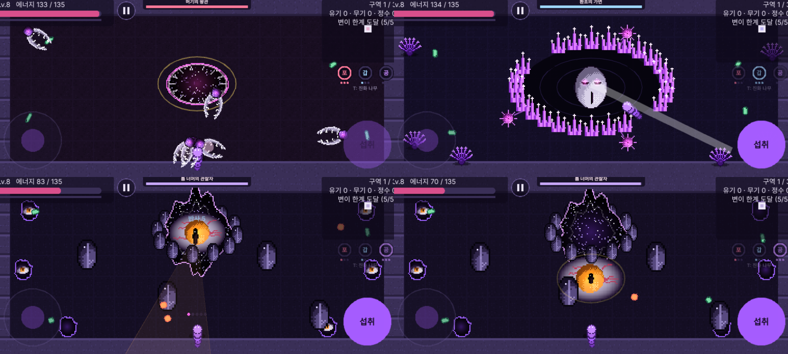

# 공허 기생충 (Void Parasite)

공허 배경의 2D 픽셀 로그라이크 · 생존 · 진화 게임 프로토타입.
플레이어는 유기물과 무기물을 먹고 탈피하며 진화하는 공허 기생충이다.

- 엔진: Phaser 3.80.1 (HTML 파일 하나, 외부 에셋 없음 — 모든 그래픽은 코드로 그린 픽셀)
- 화면: 모바일 가로 (왼쪽 조이스틱 + 오른쪽 물기/섭취 버튼), PC는 키보드
- 목표: 한 판 평균 약 10분 · 3개 구역 · 엔딩 2개 (공허에 남기 / 밖으로 나가기)
- 비상업적 연습 프로젝트. 리그 오브 레전드 '공허' 세계관에서 이름만 빌려 왔고, 몬스터 그림은 모두 고유 디자인이다.

## 플레이

`index.html`을 브라우저로 열면 된다 (인터넷 연결 필요 — Phaser를 CDN에서 불러옴).

| 조작 | 모바일 | PC |
|---|---|---|
| 이동 | 왼쪽 조이스틱 (반만 밀면 살금살금) | WASD · 방향키 (Shift: 살금살금) |
| 물기 / 섭취 | 오른쪽 버튼 탭 / 누르고 있기 | Space |
| 탈피 (둥지에서) | 탈피 버튼 | E |
| 특수 스킬 (특수 퀘스트를 깬 뒤) | 오른쪽 작은 스킬 버튼 | Q |
| 일시정지 | ⏸ | P · Esc |

## 현재 내용 (v31)

- **시작 화면 · 진화 나무**: 포식·갑각·공허 분화 조건과 단계별 능력. 플레이 중에는 오른쪽 위 진화 고리 3개(누르거나 T)로 열고 닫는다
- **1구역**: 둥지·번식지·광맥·독 늪·소용돌이·포식자 둥지·암흑 방 · 카직스, 렉사이, 제르사이 유생, 보이드링
- **2구역**: 공허 산호 숲(부서지는 산호, 가시 산호충, 정예 산호 여왕) · 심연의 감시탑(빛과 그림자, 빛 포자, 정예 감시자)
- **보스 · 라벤더 바다**: 2구역 출구 뒤 '라벤더 아래의 여제' (입장 연출 있음)
  - 1페이즈: 수면 아래 거대한 그림자 — 돌진(꺼진 불빛 쪽으로는 안 옴) · 꼬리 · 산호 가시, 공격 3번마다 수면 위로 솟을 때만 물 수 있다
  - 2페이즈 '가면이 벗겨진 여제' (변신 연출): 거울 선 너머 **거울 속의 나**로만 공격할 수 있고, 여제의 공격은 나와 거울 속의 나 어느 쪽에 맞아도 아프다 — 가면의 합창 · 들숨(끌어당겨 삼킴) · 떨어지는 가면 · 거울 뒤집기
- **특수 퀘스트 · 중간 보스**: 분화가 3단계가 되면 둥지에 균열이 열리고, 따로 떨어진 방에서 중간 보스와 싸운다 (입장 연출)
  - 포식: 허기의 왕관 — 몸 없이 구멍과 송곳니 턱 6쌍. 턱이 흩어져 사냥할 때만 구멍을 물 수 있고, 들숨에 유충을 빼앗기면 턱이 커진다
  - 갑각: 숨 쉬는 산호 환초 — 틈으로만 드나드는 산호 고리 안의 가면. 고리가 부풀고, 묶인 산호충을 끊으면 고리가 무너진다
  - 공허: 틈 너머의 관찰자 — 응시를 갑주 조각 그림자로 피하고, 가장자리에서 뜬 눈을 모두 감기면 큰 눈이 끌려 나온다
  - 이기면 특수 스킬: 포식 돌진 / 결정 방벽 / 균열 도약 (스킬 버튼 · PC는 Q)
- **엔딩 2개**: 공허에 남기 / 밖으로 나가기
- **진화 계통**: 포식(공격 · 흡수) / 갑각(반사 · 수정 방어) / 공허(원거리 공허 침 · 권속) — 변이는 1구역에서 3회, 2구역부터 5회까지, 계통마다 겉모습이 바뀜

## 이미지 (`assets/`)

직접 그린 이미지를 넣는 폴더.

## 테스트 도구 (`tools/`)

자동 플레이 봇으로 밸런스를 잰다. Node + Playwright(Chromium) 필요.

- `bot.js` — 페이지 안에서 도는 자동 플레이어 + 빨리감기(`ff`) + 지표 수집(`stats`)
- `run.js` — `node run.js <태그> <판 수> <초> [출구 시간] [html]` → `rounds/<태그>/stats.json`
  - 환경 변수: `GUIDE=1`(탈피하러 둥지로), `LIN=p|c|v|mix`(진화 계통), `PRE="<시작 전 실행할 코드>"`, `SEEDOFF`
- `z2run.sh`, `pz2.sh` — 2구역 직행 테스트 / 계통별 전투력 비교
- `shots.js` — 보고용 장면 캡처
- `mbBot30.js` — 중간 보스(v30) 자동 플레이: `node mbBot30.js <판 수> <레벨> <p|c|v> <tank|dodge>` (`mbBot.js`는 v29 보스용)
- `t30.js` — 중간 보스(v30) 장면 캡처: `node t30.js <p|c|v>`
- `t29.js` — 특수 퀘스트 흐름 장면 캡처: `node t29.js <p|c|v>`
- `emBot.js` — 여제 보스전 자동 플레이: `node emBot.js <판 수> <레벨> <계통 예: p2c1v0> <tank|dodge> [p2]` (tank = 피하지 않고 맞으며 물기, dodge = 예고를 보고 피하기, p2 = 2페이즈부터)
- `bossbot.js` — v27 보스('공허를 걷는 자')용 자동 플레이
- `qtest.js` — 산호 여왕 끼임 측정
- `sync.py`, `mkver.py` — 테스트용 사본 생성 (경로는 작업 환경 기준이라 바꿔서 써야 함)

## 변경 기록

- **v31** 변이 한계: 1구역 3회 · 2구역부터 5회
- **v30** 중간 보스 교체: 허기의 왕관 · 숨 쉬는 산호 환초 · 틈 너머의 관찰자 (시안 2차례)
- **v29** 분화 3단계 특수 퀘스트 · 중간 보스 3종(각성한 카직스+렉사이, 결정 여왕, 각성한 감시자) · 특수 스킬 3종
- **v28** 보스를 2페이즈 '라벤더 아래의 여제'로 교체 (입장·변신·처치 연출, 거울 속의 나로 공격하는 2페이즈), 난이도 상향
- **v27** 진화 나무(시작 설명서 · 퀘스트창), 산호 여왕 끼임 수정, 보스전 '공허를 걷는 자' + 엔딩 2개

- **v26** 2구역 추가 (공허 산호 숲 · 심연의 감시탑, 정예 2종), 공허 계통 2구역 보정
- **v25** 탈피 진화 계통 (포식 · 갑각 · 공허), 계통별 외형 변화, 변이 한계 5회
- v1 ~ v24 자동 플레이 30회 피드백 라운드, 덤불 개편, 1구역 생태계 · 몬스터 · UI 다듬기

## 폴더

- `index.html` — 게임 (이 파일 하나로 실행)
- `tools/` — 자동 플레이 봇 · 밸런스 테스트
- `dev/` — 큰 기능을 넣을 때 쓴 패치 원본 (진화 계통, 2구역)
- `docs/` — 스크린샷

