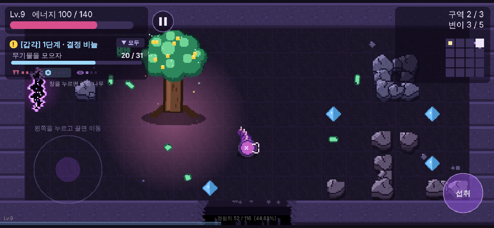
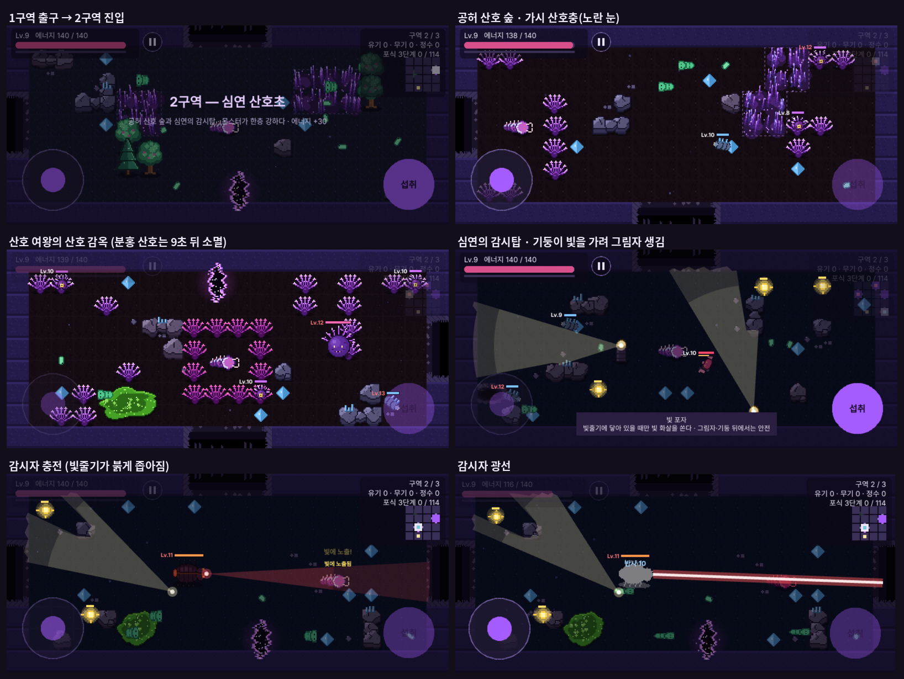

# 공허 기생충 (Void Parasite)

공허 배경의 2D 픽셀 로그라이크 · 생존 · 진화 게임 프로토타입.
플레이어는 유기물과 무기물을 먹고 탈피하며 진화하는 공허 기생충이다.

- 엔진: Phaser 3.80.1 (HTML 파일 하나, 외부 에셋 없음 — 모든 그래픽은 코드로 그린 픽셀)
- 화면: 모바일 가로 (왼쪽 조이스틱 + 오른쪽 물기/섭취 버튼), PC는 키보드
- 목표: 한 판 평균 약 10분 · 3개 구역 · 엔딩 2개 (공허에 남기 / 밖으로 나가기)
- 비상업적 연습 프로젝트. 리그 오브 레전드 '공허' 세계관에서 이름만 빌려 왔고, 몬스터 그림은 모두 고유 디자인이다.

## 플레이

`index.html`을 브라우저로 열면 된다 (인터넷 연결 필요 — Phaser를 CDN에서 불러옴).

| 조작 | 모바일 | PC |
|---|---|---|
| 이동 | 왼쪽 아무 데나 누르고 끌기 — 떠다니는 조이스틱 (반만 밀면 살금살금) | WASD · 방향키 (Shift: 살금살금) |
| 공격 / 섭취 | 오른쪽 위 공격 버튼 / 그 아래 섭취 버튼 누르고 있기 | Space / F 누르고 있기 |
| 탈피 (둥지에서) | 탈피 버튼 | E |
| 특수 스킬 (특수 퀘스트를 깬 뒤) | 오른쪽 작은 스킬 버튼 | Q |
| 일시정지 | ⏸ | P · Esc |
| 전체 화면 | 일시정지 창·시작 화면 오른쪽 위 '⛶ 전체 화면' | 같음 |

## 현재 내용 (v77)

- **시작 화면 · 진화 나무**: 포식·갑각·공허 분화 조건과 단계별 능력. 플레이 중에는 오른쪽 위 진화 고리 3개(누르거나 T)로 열고 닫는다
- **1구역**: 둥지·번식지·광맥·독 늪·소용돌이·포식자 둥지·암흑 방 · 낫그늘(옛 카직스), 땅울음(옛 렉사이), 제르사이 유생, 보이드링
- **2구역**: 공허 산호 숲(부서지는 산호, 가시 산호충, 정예 산호 여왕) · 심연의 감시탑(빛과 그림자, 빛 포자, 정예 감시자)
- **최종 보스 · 무리의 둥지**: 2구역 출구 뒤 「한 몸의 무리」 — 수백 마리 유충이 한 몸처럼 모양을 바꾸며 공격, 무리가 흩어질 때 금빛 여왕을 문다 (50%에서 거대 유충으로 변신)
- **특수 퀘스트 · 중간 보스**: 분화가 3단계가 되면 둥지에 균열이 열리고, 따로 떨어진 방에서 중간 보스와 싸운다 (입장 연출)
  - 포식: 허기의 왕관 — 몸 없이 구멍과 송곳니 턱 6쌍. 턱이 흩어져 사냥할 때만 구멍을 물 수 있고, 들숨에 유충을 빼앗기면 턱이 커진다
  - 갑각: 숨 쉬는 산호 환초 — 틈으로만 드나드는 산호 고리 안의 가면. 고리가 부풀고, 묶인 산호충을 끊으면 고리가 무너진다
  - 공허: 틈 너머의 관찰자 — 응시를 갑주 조각 그림자로 피하고, 가장자리에서 뜬 눈을 모두 감기면 큰 눈이 끌려 나온다
  - 이기면 특수 스킬: 포식 돌진 / 결정 방벽 / 균열 도약 (스킬 버튼 · PC는 Q)
- **엔딩 2개**: 공허에 남기 / 밖으로 나가기
- **진화 계통**: 포식(공격 · 흡수) / 갑각(반사 · 수정 방어 · 3단계는 한 번 껍질이 터지며 부활) / 공허(원거리 공허 침 · 권속) — 변이는 1구역에서 3회, 2구역부터 5회까지, 계통마다 겉모습이 바뀜

## 이미지 (`assets/`)

직접 그린 이미지를 넣는 폴더.

## 테스트 도구 (`tools/`)

자동 플레이 봇으로 밸런스를 잰다. Node + Playwright(Chromium) 필요.

- `bot.js` — 페이지 안에서 도는 자동 플레이어 + 빨리감기(`ff`) + 지표 수집(`stats`)
- `run.js` — `node run.js <태그> <판 수> <초> [출구 시간] [html]` → `rounds/<태그>/stats.json`
  - 환경 변수: `GUIDE=1`(탈피하러 둥지로), `LIN=p|c|v|mix`(진화 계통), `PRE="<시작 전 실행할 코드>"`, `SEEDOFF`
- `z2run.sh`, `pz2.sh` — 2구역 직행 테스트 / 계통별 전투력 비교
- `shots.js` — 보고용 장면 캡처
- `mbBot30.js` — 중간 보스(v30) 자동 플레이: `node mbBot30.js <판 수> <레벨> <p|c|v> <tank|dodge>` (`mbBot.js`는 v29 보스용)
- `t30.js` — 중간 보스(v30) 장면 캡처: `node t30.js <p|c|v>`
- `t29.js` — 특수 퀘스트 흐름 장면 캡처: `node t29.js <p|c|v>`
- `emBot.js` — 여제 보스전 자동 플레이: `node emBot.js <판 수> <레벨> <계통 예: p2c1v0> <tank|dodge> [p2]` (tank = 피하지 않고 맞으며 물기, dodge = 예고를 보고 피하기, p2 = 2페이즈부터)
- `bossbot.js` — v27 보스('공허를 걷는 자')용 자동 플레이
- `qtest.js` — 산호 여왕 끼임 측정
- `sync.py`, `mkver.py` — 테스트용 사본 생성 (경로는 작업 환경 기준이라 바꿔서 써야 함)

## 변경 기록

- **v77** 허기의 왕관 더 어렵게: 회전 베기(크고 빠르게, 칼날 원이 퍼짐) · 몸 테두리 안 흡수 · 턱 쌍마다 다른 돌진(길게 / 난이도별 연속) · 커질수록 범위·피해 증가
- **v76** 포식 몸통 작은 돌기 · 포식 중간 보스: 흡수하면 회복, 물어뜯기 더 어렵게, 턱마다 톱날 이빨, 새 패턴 회전 베기
- **v75** 게임 안 포식 턱을 정지 그림처럼 픽셀 칸으로 · 몸통 대안 시안(선택 대기)
- **v74** 포식 2·3단계 몸통에 등줄기 톱날
- **v73** 물었을 때 이펙트를 빨간 원 + 흘러내리는 피만으로 단순하게
- **v72** 포식 턱 = 톱날(안쪽 톱니) · 물렸을 때 몬스터가 붉게 번쩍이고 베인 자국 + 피 방울
- **v71** 포식 턱을 얇게 휜 검날로 · 통째 삼키기 턱도 얇게 · 포식 2단계 눈 = 연노랑 눈 + 붉은 눈썹
- **v70** 포식 턱 크기 단계별(1<2<3) · 포식 특수 스킬 = 통째 삼키기(체력 낮은 적은 삼키고 회복, 아니면 큰 피해 + 출혈) · 2단계 눈 시안(선택 대기)
- **v69** 포식 턱을 낫 모양 칼날로 + 평소 씹는 움직임 · 갑각 특수 스킬 = 수정 돌진(부딪히면 큰 피해 + 넉백) · 갑각 차지 삭제 · 포식 특수 스킬 대안(선택 대기)
- **v68** 포식 3단계 이빨은 턱 밑 앞쪽만 남기고 얼굴 옆으로 뻗은 것 삭제
- **v67** 포식 3단계는 물 때 갈고리 턱이 크게 커지며 넓게 벌렸다 다묾
- **v66** 포식 3단계 눈을 턱 쪽으로 1칸씩 늘린 가로 2칸 눈으로 (매섭게)
- **v65** 포식 3단계: 머리 앞 이빨 왕관 + 작은 눈 4개, 마디는 원래 가시
- **v64** 포식 3단계: 분홍 목구멍 + 삼킨 것이 비치는 몸 · 공명 갑각 결정 작게 · 갑각은 단계마다 이동 속도 −4%
- **v63** 갑각 모습: 먹은 결정이 머리·마디에서 돋아남(단계마다 늘어남) · 포식 3단계 시안 2(선택 대기)
- **v62** 공허 3단계 모습에 연한 초승달 무늬(개발자가 고른 v3+c1 모습) · 갑각 모습 / 포식 3단계 / 갑각 차지 모션 시안(선택 대기)
- **v61** 공격 버튼(위)과 섭취 버튼(아래) 분리 · 키보드 Space 공격 / F 섭취 · 갑각은 느리지만 강한 박치기, 누르고 있으면 차지 · 공명 갑각 단단한 모습 · 공허 머리 앞 턱 모양 삭제
- **v60** 진화 나무를 그림 위주로(단계별 모습 칸 + 특수 스킬 장면 카드) · 처음 시작할 때 포식·갑각·공허 기초 슬라이드 2장 · 일시정지에 '게임 설명'
- **v59** 계통별 기본 공격: 갑각은 몸통 박치기(부딪히면 수정 파편), 공허는 검은 구체를 뱉는 원거리 공격 · 진화 나무 이미지 시안 3가지(선택 대기)
- **v58** 포식 1단계부터 머리의 갈고리 턱(3단계는 큰 입까지)이 물 때 실제로 벌렸다 다묾 · 갑각/공허 공격 시안 6가지(선택 대기)
- **v57** 맞을 때 화면 흔들림을 약 1/3로 줄임
- **v56** 기본 공격(물기) 연출을 단순하게 — 돌진·잔상·흰 부채꼴·물결 효과를 없애고 송곳니로 물기만, 맞으면 몬스터 몸에 이빨 자국이 잠깐 남음
- **v55** 배고픔 삭제 — 시간이 지나도 줄지 않고, 막대는 **체력**으로만 쓴다(피격·독 웅덩이로 줄고 먹이·탈피로 회복). 화면 글씨 '에너지' → '체력'
- **v54** 9판 플레이 점검: 퀘스트 창 숫자가 목표를 넘지 않게(예: 312 / 114 → 114 / 114), 땅울음 안내 글씨가 퀘스트 창과 겹치지 않게 창 밑으로
- **v53** 송곳니 한 쌍이 다물 때 서로 교차하지 않게 다시 그림
- **v52** 물기 턱 모션을 작은 송곳니 한 쌍으로 확정
- **v51** 물기 전진은 맞았을 때만 조금(허공 물기로 이동 불가), 땅울음이 솟을 때 화면 흔들림을 줄이고 땅 갈라짐 효과, 턱 모션 3안(선택 대기)
- **v50** 물기 부채꼴 ±45° + 조준 보정(앞쪽 ±60° 안 가장 가까운 몬스터 쪽으로 머리를 돌려 문다)
- **v49** 물기 범위를 둥근 부채꼴로 확정하고 각도를 좁힘(±40°, 거리 그대로)
- **v48** 물기 범위를 예전 사거리에 맞춘 모양 4안(둥근 부채꼴·둥근 타원·둥근 사다리꼴·위아래 턱, 선택 대기) + 물 때 턱을 '딱' 다무는 모션
- **v47** 물기 범위를 둥근 사다리꼴로(모서리 둥글게, 바깥 끝 볼록)
- **v46** 물기 범위를 사다리꼴로(그림과 판정 모두), 물 때 몸이 앞으로 살짝 나가며 공격
- **v45** 물기·섭취 모션을 '용수철 꿈틀'로 확정 — 물면 몸을 움츠렸다 잔상을 남기며 튀어 나가고, 먹을 때는 몸 전체가 꿈틀대며 먹이를 빨아들임
- **v44** 물기·섭취에 캐릭터 모션(먹는 동안 머리가 먹이 쪽으로), 물기 범위 표시를 얇은 고리로. 모션 3안 중 선택 대기 (`docs/v44/`)
- **v43** 계통 퀘스트 창을 알리미 모양으로(▼ 모두 / ▲ 접기로 세 계통 펼치기), 경험치 막대 연하게. 시작 연출·진화 나무 시안 (`docs/v43/`)
- **v42** 경험치 막대를 화면 맨 밑으로(메이플식), 포식·갑각·공허 진행을 에너지 막대 밑 '퀘스트 창'으로 (모양 3안 중 선택 대기, `docs/v42/`)
- **v41** 전체 화면 버튼(일시정지 창·시작 화면). 먹는 방식 F1~F4 · UI W1~W4 새 시안 (`docs/v41/`)
- **v40** 글자 깨짐 수정 — 폰 화면의 실제 화소에 맞춰 1~3배 해상도로 그림(느린 기기면 자동으로 낮춤). 화면 크기·초반 스킬·UI 시안 (`docs/v40/`)
- **v39** 최종 보스: 1페이즈 회전하는 세 겹 고리 · 2페이즈 쫓아오는 고리 · 별똥 은하 + 금빛 유도탄 · 손 공격 개편(쓸어 가는 손 → 따라 걷는 손, 손끝마디 다섯 개를 물어 터뜨리면 멈춤) · 여왕이 쓰러지면 무리가 한 점으로 빨려 들고 빛 한 점에서 끝남
- **v38** 엔딩에 진화 기록 카드(별명·탈피 순서·보스 기록·지난 기록), 최종 보스 세 겹 고리 · 쪼개진 무리가 다음 공격까지 남음 · 밀물/행성 고리 삭제
- **v37** 중간 보스 방에서 멈추던 원인 수정(출구 화살표), 엔딩에 공허가 찢어지며 바깥 세계가 열리는 연출, 계통·중간 보스 난이도 맞춤
- **v36** 최종 보스 교체: 「한 몸의 무리」 — 수백 유충이 손바닥·은하·고리·혜성·블랙홀·세포 분열·밀물로 모양을 바꾸며 싸운다, 흩어질 때 여왕을 문다
- **v35** 조이스틱 고리 크게(55), 개구리 점프 길이가 상황 따라 달라짐(짧게·중간·긴 도약), 중간 보스 이름 연출 +0.5초
- **v34** 모바일 조작: 떠다니는 조이스틱(누른 자리에 생기고 떼면 사라짐), 작고 반투명한 섭취 버튼
- **v33** 멈춤 대책(AI별 오류 격리 · 루프 전체 보호 · 감시견 · 오류 표시 · 자동 저장/이어하기), 포식 유기물 보상 상향, 카직스→낫그늘 · 렉사이→땅울음 이름 변경, 여제·갑각·산호 환초 보정
- **v32** 갑각 3단계 '갑각 폭발 탈피'(1회 부활), 중간 보스·보스 난이도 측정 도구(mbBot31 · emBot31 · run3)
- **v31** 변이 한계: 1구역 3회 · 2구역부터 5회
- **v30** 중간 보스 교체: 허기의 왕관 · 숨 쉬는 산호 환초 · 틈 너머의 관찰자 (시안 2차례)
- **v29** 분화 3단계 특수 퀘스트 · 중간 보스 3종(각성한 카직스+렉사이, 결정 여왕, 각성한 감시자) · 특수 스킬 3종
- **v28** 보스를 2페이즈 '라벤더 아래의 여제'로 교체 (입장·변신·처치 연출, 거울 속의 나로 공격하는 2페이즈), 난이도 상향
- **v27** 진화 나무(시작 설명서 · 퀘스트창), 산호 여왕 끼임 수정, 보스전 '공허를 걷는 자' + 엔딩 2개

- **v26** 2구역 추가 (공허 산호 숲 · 심연의 감시탑, 정예 2종), 공허 계통 2구역 보정
- **v25** 탈피 진화 계통 (포식 · 갑각 · 공허), 계통별 외형 변화, 변이 한계 5회
- v1 ~ v24 자동 플레이 30회 피드백 라운드, 덤불 개편, 1구역 생태계 · 몬스터 · UI 다듬기

## 폴더

- `index.html` — 게임 (이 파일 하나로 실행)
- `tools/` — 자동 플레이 봇 · 밸런스 테스트
- `dev/` — 큰 기능을 넣을 때 쓴 패치 원본 (진화 계통, 2구역)
- `docs/` — 스크린샷

